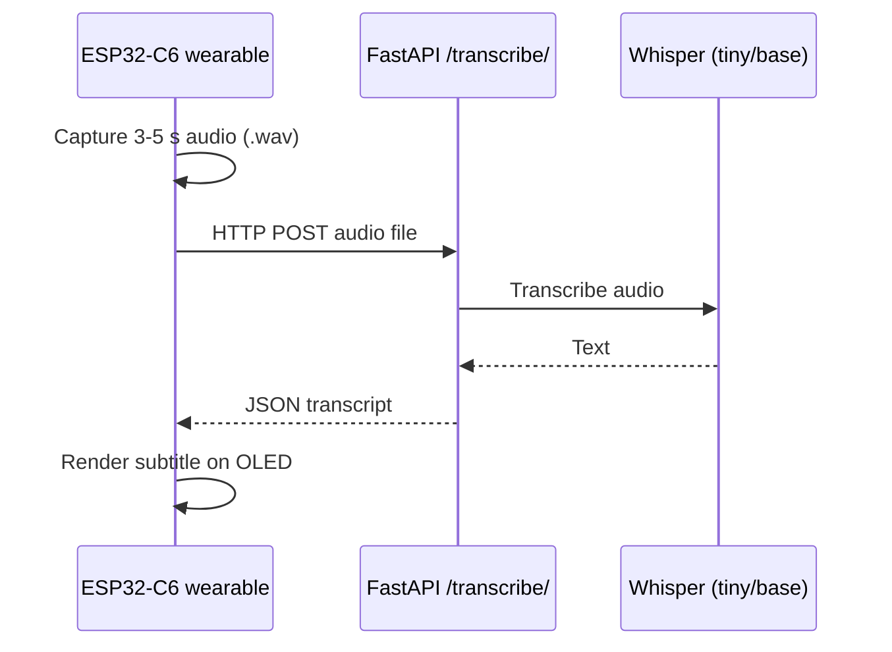

# 🦻 TalkVision: Smart Wearable Subtitles for the Hearing-Impaired

**TalkVision** is an AI-powered smart wearable designed to empower the hearing-impaired by providing **real-time subtitles** of spoken language through an IoT-enabled device and cloud-based speech-to-text processing. This repository contains the **cloud software backend** built using **FastAPI** and **Whisper ASR**, which processes short audio clips sent from an ESP32-based wearable and returns transcribed subtitles in JSON format.

    [](https://huggingface.co/spaces/the-harsh-vardhan/TalkVision)

**In short:** an ESP32-C6 wearable streams short audio clips to this FastAPI service, Whisper transcribes them, and the subtitle text is shown on an OLED display. [Try the live demo](https://huggingface.co/spaces/the-harsh-vardhan/TalkVision).



---

## 📌 Project Features

- 🎙️ Accepts small audio chunks (`.wav`) from an IoT device over HTTP POST
- 🧠 Processes speech using OpenAI’s **Whisper** ASR (Tiny/Base models)
- 🌐 Deployable to **Render**, **Railway**, or any cloud with Python support
- 📤 Returns real-time subtitles in **JSON** for immediate display
- 📱 ESP32-C6 acts as the IoT client, with OLED subtitle rendering
- 📦 Lightweight & Free-tier friendly (edge deployable)

---

## 🚀 How It Works

1. ESP32-C6 captures 3–5 second audio via onboard mic
2. Audio is posted to the cloud API using HTTP
3. Whisper model transcribes the audio to text
4. JSON response with the transcript is sent back
5. ESP32 parses JSON and displays subtitle on OLED in real-time

---

## 🧰 Tech Stack

| Component          | Tech Used               |
| ------------------ | ----------------------- |
| Cloud Framework    | FastAPI (Python)        |
| Speech Recognition | Whisper ASR (Tiny/Base) |
| Deployment         | Render / Railway        |
| IoT Device         | ESP32-C6-DEVKITC-1-N8   |
| Display            | OLED (via Ray Optics)   |
| Format             | JSON                    |

---

## 🛠️ Setup Instructions

### 1. Clone the repo

```bash
git clone https://github.com/The-Harsh-Vardhan/TalkVision.git
cd TalkVision
```

### 2. Install dependencies

```bash
pip install -r requirements.txt
```

### 3. Run the server locally

```bash
uvicorn app:app --reload
```

### 4. Deploy to Cloud Platforms

#### Hugging Face Spaces (Recommended):

🚀 **Live Demo**: [https://huggingface.co/spaces/the-harsh-vardhan/TalkVision](https://huggingface.co/spaces/the-harsh-vardhan/TalkVision)

1. Fork this repository
2. Create a new Space on [Hugging Face Spaces](https://huggingface.co/spaces)
3. Choose **Docker** as SDK
4. Upload the files and your Space will auto-deploy

#### Render Deployment:

1. Create a new Web Service on [Render](https://render.com)
2. Connect your GitHub repository
3. Use the following settings:
   - **Build Command**: `pip install -r requirements.txt`
   - **Start Command**: `uvicorn app:app --host 0.0.0.0 --port $PORT`
   - **Environment**: Python 3.9+
4. Deploy and get your API URL

#### Railway Deployment:

1. Create a new project on [Railway](https://railway.app)
2. Connect your GitHub repository
3. Railway will automatically detect and deploy your FastAPI app
4. Your API will be available at the provided Railway URL

#### Environment Variables (Optional):

- `WHISPER_MODEL`: Set to "tiny" for faster inference or "base" for better accuracy
- `MAX_FILE_SIZE`: Maximum audio file size in bytes (default: 25MB)

## 📡 API Endpoints

### GET /

Returns API status

**Response:**

```json
{
  "message": "TalkVision API is running"
}
```

### POST /transcribe/

Transcribe audio to text

**Parameters:**
| Field | Type | Description |
|-------|------|-------------|
| file | audio/wav | Audio chunk uploaded via POST |

**Response:**

```json
{
  "transcript": "This is your subtitle in real-time."
}
```

**Example Usage with cURL:**

```bash
# For local development
curl -X POST "http://127.0.0.1:8000/transcribe/" \
     -H "accept: application/json" \
     -H "Content-Type: multipart/form-data" \
     -F "file=@audio_sample.wav"

# For Hugging Face Spaces
curl -X POST "https://the-harsh-vardhan-talkvision.hf.space/transcribe/" \
     -H "accept: application/json" \
     -H "Content-Type: multipart/form-data" \
     -F "file=@audio_sample.wav"
```

**Example ESP32 Integration:**

```cpp
// ESP32 HTTP POST example - Use your deployed URL
HTTPClient http;
http.begin("https://the-harsh-vardhan-talkvision.hf.space/transcribe/");
http.addHeader("Content-Type", "multipart/form-data");
// Add your audio file data here
int httpResponseCode = http.POST(audioData);
```

---

## 📁 Project Structure

```

TalkVision/
├── app.py # Main FastAPI application
├── whisper_model.py # Whisper ASR model wrapper
├── utils.py # Utility functions for audio processing
├── requirements.txt # Python dependencies
├── Procfile # Deployment configuration
├── runtime.txt # Python version specification
├── .gitignore # Git ignore rules
├── .dockerignore # Docker ignore rules
└── README.md # Project documentation

```

---

## 🔧 Local Development

### Prerequisites

- Python 3.9+
- pip package manager
- Audio codecs (automatically installed with dependencies)

### Installation Steps

1. **Clone and setup:**
   ```bash
   git clone https://github.com/The-Harsh-Vardhan/TalkVision.git
   cd TalkVision
   python -m venv venv
   ```

````

2. **Activate virtual environment:**

   ```bash
   # Windows
   venv\Scripts\activate

   # macOS/Linux
   source venv/bin/activate
   ```

3. **Install dependencies:**

   ```bash
   pip install -r requirements.txt
   ```

4. **Run development server:**

   ```bash
   uvicorn app:app --reload --host 127.0.0.1 --port 8000
   ```

5. **Test the API:**
   - Visit: `http://127.0.0.1:8000` for status
   - API docs: `http://127.0.0.1:8000/docs`
   - Test transcription with Swagger UI or cURL

---

## 🚀 Quick Test

Test the API with a sample audio file:

```bash
# Create a test audio file (you'll need an actual .wav file)
curl -X POST "http://127.0.0.1:8000/transcribe/" \
     -H "accept: application/json" \
     -H "Content-Type: multipart/form-data" \
     -F "file=@test_audio.wav"
```

Expected response:

```json
{
  "transcript": "Your transcribed text will appear here"
}
```

---

## ⚡ Performance Notes

- **Model Selection**:
  - `tiny`: Fastest inference, lower accuracy
  - `base`: Balanced speed and accuracy (recommended)
  - `small`: Better accuracy, slower inference
- **Audio Format**: Supports WAV, MP3, M4A, FLAC
- **File Size Limit**: 25MB per request
- **Processing Time**: 2-8 seconds depending on audio length and model

---

## 🛠️ Configuration

### Environment Variables

Create a `.env` file (optional):

```env
WHISPER_MODEL=base
MAX_FILE_SIZE=26214400
LOG_LEVEL=info
```

### Model Configuration

Edit `whisper_model.py` to change models:

```python
# For faster inference (less accurate)
model = whisper.load_model("tiny")

# For better accuracy (slower)
model = whisper.load_model("small")
```

---

## 🧪 Testing

### Manual Testing

1. Start the server: `uvicorn app:app --reload`
2. Open `http://127.0.0.1:8000/docs`
3. Use the interactive API documentation to test

### cURL Testing

```bash
# Health check
curl http://127.0.0.1:8000/

# Transcription test
curl -X POST "http://127.0.0.1:8000/transcribe/" \
     -H "Content-Type: multipart/form-data" \
     -F "file=@sample.wav"
```

---

## 🤝 Contributing

1. Fork the repository
2. Create a feature branch: `git checkout -b feature-name`
3. Commit changes: `git commit -am 'Add feature'`
4. Push to branch: `git push origin feature-name`
5. Submit a Pull Request

---

## 📄 License

This project is open source and available under the [MIT License](LICENSE).

---

## 👨‍💻 Author

**The-Harsh-Vardhan**

- GitHub: [@The-Harsh-Vardhan](https://github.com/The-Harsh-Vardhan)
- Project: [TalkVision](https://github.com/The-Harsh-Vardhan/TalkVision)

---

## 🙏 Acknowledgments

- [OpenAI Whisper](https://github.com/openai/whisper) for speech recognition
- [FastAPI](https://fastapi.tiangolo.com/) for the web framework
- [Render](https://render.com/) / [Railway](https://railway.app/) for deployment platforms
````
